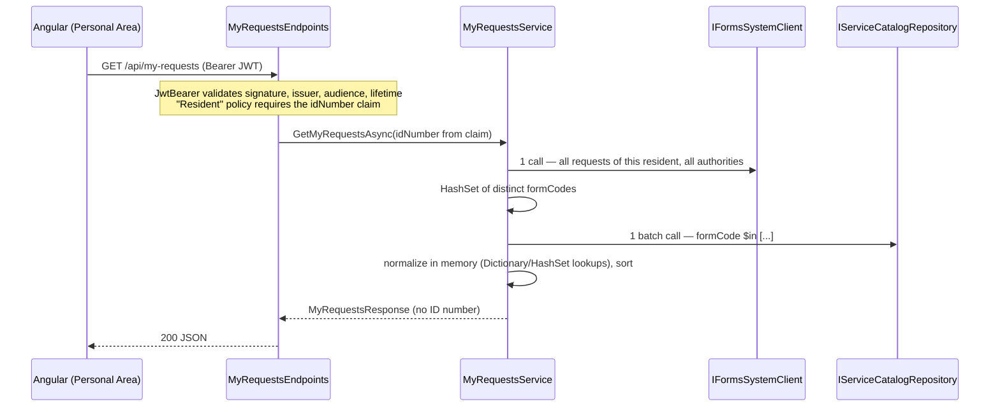

# RA_MuniAnnouncements — "הבקשות שלי"

Microservice for the Personal Area that gathers a resident's requests from **all** local authorities into one normalized view, and an Angular component that displays it.

> The User Stories, grooming questions, Part B (work plan) and Part C (answers) are in the separate Word document submitted alongside this repository.
>
> API reference, file-by-file layout and flow diagrams: [docs/ARCHITECTURE.md](docs/ARCHITECTURE.md).

---

## Repository layout

```
RA_MuniAnnouncements.slnx
src/RA_MuniAnnouncements.Api/          .NET 10 Web API
  Program.cs                            ~15 lines: AddApplicationServices → UseApplicationMiddleware → MapApplicationEndpoints
  Application/                          Program extensions: DI per layer · middleware pipeline · "/api" route group · CLI commands
  Endpoints/                            Minimal API modules, one file per feature:
    MyRequestsEndpoints.cs              GET /api/my-requests (secured, identity from the "idNumber" claim)
    AuthEndpoints.cs                    POST /api/auth/login (MongoDB Users + password hash → JWT)
  Business/                             IMyRequestsService + MyRequestsService (exam 4.1–4.7) · LoginService · MyRequestsOptions
  DataAccess/                           MongoDB: ServiceCatalog ($in batch read) · Users · repository interfaces · MongoDbOptions
    Seed/ServiceCatalog.json            catalog documents in the exam's JSON shape
  ExternalServices/                     IFormsSystemClient + hard-coded mock (its API is still being built — exam p.6)
  Models/                               RawFormRequest (inbound, has PII) · ServiceCatalogEntry · AuthorityDefinition
                                        MyRequestDto / MyRequestsResponse (outbound — no ID number by construction)
    Exceptions/                         DependencyUnavailableException (outage → 503)
  Middleware/                           central exception → ProblemDetails (503 / 500, no stack traces)
  Security/                             JWT settings + issuer · "Resident" policy and claim names
  DevTools/                             --seed-catalog and --create-user CLI commands (nothing runs at startup)
tests/RA_MuniAnnouncements.Tests/       normalization and HTTP authentication tests
client/my-requests-ui/                  Angular 20 app (standalone, OnPush, Signals, zoneless)
```

## Prerequisites

| Tool | Version |
|---|---|
| .NET SDK | 10.0+ |
| MongoDB | A running local server on port 27017, or a configured connection string |
| Node.js | 20.19+ or 22.12+ |
| Angular CLI | 20 (used through `npx`, no global install needed) |

## Run it (Windows PowerShell)

**1. MongoDB: catalog and an account** — start MongoDB, load the catalog, then create a user:

The defaults in `appsettings.json` connect to `mongodb://localhost:27017`, database
`RA_MuniAnnouncements`, collections `ServiceCatalog` and `Users`. Override `MongoDb:ConnectionString` and
`MongoDb:DatabaseName` for your deployment (environment variables: `MongoDb__ConnectionString`
and `MongoDb__DatabaseName`).

```powershell
dotnet run --project src/RA_MuniAnnouncements.Api -- --seed-catalog
# Upserts DataAccess/Seed/ServiceCatalog.json by formCode (safe to re-run) and creates a unique index on formCode.
# Optional: --seed-catalog <path-to-json> to load other documents.
```

The seed holds the exam document (ARNONA_DISCOUNT / 6500), the same form for a second authority with
different rules (7400), and PARKING_PERMIT. Form `BUILDING_PERMIT` and authority `8600` under PARKING_PERMIT
are deliberately absent, so the demo shows the "omit + log" paths.

```powershell
dotnet run --project src/RA_MuniAnnouncements.Api -- --create-user resident 012345678
# Enter a password of 12–1024 characters at the prompt (not echoed or passed as an argument).
```

Provisioning stores `Username`, `NormalizedUsername` (trimmed, uppercase), `PasswordHash`
(ASP.NET Core Identity PBKDF2 with a random salt), and `IdNumber`, with an ObjectId `_id`.
It creates a unique index on `NormalizedUsername`; duplicate accounts fail without overwriting users.
Existing records must follow this schema and use Identity password hashes; plaintext passwords are not accepted.
No account is created automatically. `012345678` and `000000018` are resident IDs with demo request data.

**2. Backend** — terminal 1:

```powershell
dotnet run --project src/RA_MuniAnnouncements.Api
# listens on http://localhost:5098
```

**3. Frontend** — terminal 2:

```powershell
cd client/my-requests-ui
npm install
npm start
# open http://localhost:4200
```

Sign in with the provisioned username and password. Angular stores the JWT in
`localStorage['auth_token']`; the interceptor attaches `Authorization: Bearer <token>` to
relative `/api/` requests. Logout removes the token, and a protected API `401` returns to login.
The proxy only routes network traffic; it never reads signing settings or creates authentication headers.

**Call the API directly:**

```powershell
$securePassword = Read-Host 'Password' -AsSecureString
$credentials = @{ username = 'resident'; password = [System.Net.NetworkCredential]::new('', $securePassword).Password } | ConvertTo-Json
$login = Invoke-RestMethod http://localhost:5098/api/auth/login -Method Post -ContentType 'application/json' -Body $credentials
Invoke-RestMethod http://localhost:5098/api/my-requests -Headers @{ Authorization = "Bearer $($login.token)" }
```

`POST /api/auth/login` accepts `{ "username": "resident", "password": "..." }` and returns
`{ "token": "...", "expiresAt": "..." }`. Invalid credentials return the same generic `401`,
invalid input returns `400`, and an unavailable Users database returns `503`.
Login is limited to 10 requests per minute per remote IP (`429` thereafter).
The response uses `Cache-Control: no-store`. No password/hash is included in the JWT or response.

JWT settings are under `Authentication:Jwt`: `SigningKey` (at least 32 UTF-8 bytes),
`Issuer`, `Audience`, and `ExpirationMinutes` (default 60). Login and validation use the same settings
and enforce HS256, signature, issuer, audience and expiration. The Development settings contain a
local-only key. Outside Development, configure a separate random key through deployment secrets
or `Authentication__Jwt__SigningKey`; an empty key or the bundled development key prevents startup.

| Situation | Response |
|---|---|
| No token / invalid / expired token | `401` |
| Valid token without an `idNumber` claim | `403` |
| Valid token | `200` + `{ "requests": [...] }` |
| Forms System / MongoDB unavailable | `503` ProblemDetails → UI shows retry |

## Tests

```powershell
dotnet test                                      # normalization + HTTP authentication tests
cd client/my-requests-ui
npm test -- --watch=false --browsers=ChromeHeadlessCI
```

Backend cases: exam sample end-to-end · unknown status → `בטיפול` + warning log · open past SLA → overdue · final status never overdue · exact SLA boundary (`>` not `>=`, 3 cases) · missing form → omitted + log · missing authority → omitted + log · same form, two authorities, different rules · sorting · catalog called **once** with distinct codes · no requests → no catalog call · JSON has exactly the 8 contract fields and no ID number · dates use the Israeli calendar day.

The clock is a fixed `TimeProvider`, so results never depend on when the tests run.

## How a request flows



**Complexity** for R requests and C distinct form codes: 1 Forms call + 1 catalog call; O(R) average to build the set and normalize; O(R log R) to sort. No await inside the loop, so no N+1.

## Key decisions

| Decision | Why |
|---|---|
| Minimal APIs: one `/api` `MapGroup`, static handlers returning `TypedResults` (`Results<Ok<T>, …>`), built-in `AddValidation()`, OpenAPI at `/openapi/v1.json` in Development | A small, focused API with two endpoints; handlers are plain static methods (unit-testable), and the result types are the OpenAPI contract. Auth stays in the JwtBearer middleware + `RequireAuthorization` — never decoded by hand. |
| Identity only from the validated `idNumber` claim; no id in route or query | A resident cannot request another resident's data by editing a URL. |
| `MyRequestDto` is a whitelist with no `applicantId` property | The ID number cannot leak to the client, even by an accidental serializer change. |
| Business rules use **status codes** (`actionRequiredStatuses`, `finalStatuses`), never the translated label | Labels are per-authority display text; codes are the contract. |
| `isOverdue = !final && (now − submittedAt) > slaDays` | Exam 4.4 says "greater than" — exactly at the SLA is not overdue. Computed on UTC instants. |
| Dates shown as `dd/MM/yyyy` in the **Israel** calendar day | Agreed in grooming: the resident must see the day they actually submitted. |
| Unknown authority under a known form → omit + warning log | Not specified by the exam; treated like a missing form (open grooming question). |
| Logs contain request id / form code / authority / status code only | No ID number or token in logs. Source-generated `LoggerMessage`. |
| Upstream failure → `503`, never an empty list | "No requests" and "service unavailable" must look different to the resident. |
| Angular: Signals for view state, RxJS `switchMap` for loading | Retry cancels a load still in flight; `takeUntilDestroyed` cleans up; OnPush + zoneless with no manual `detectChanges()`. |
| CTA URL is configuration (`REQUEST_ACTION_URL_TEMPLATE`) | The exam does not define it; to be agreed with the Personal Area / Forms teams. |

## Replacing the Forms System mock

ServiceCatalog and Users are already real MongoDB collections (`Application/InfrastructureServices.cs`).
Only the Forms System is a mock; replacing it changes the `AddFormsSystem()` registration in `Application/InfrastructureServices.cs` only.
Endpoints, service and tests stay as they are.

```csharp
services.AddHttpClient<IFormsSystemClient, FormsSystemHttpClient>(c => c.BaseAddress = new(formsBaseUrl))
        .AddStandardResilienceHandler();          // timeout, retry with jitter (GET only), circuit breaker
```

Real dependencies throw `DependencyUnavailableException` on timeouts or outages (the MongoDB repositories
already do); the global handler turns it into `503`.

## Authentication verification

HTTP integration tests exercise real password hashing and JWT middleware, using in-memory user and
catalog repositories (the catalog is loaded from the same seed file) instead of a live MongoDB. They cover successful login and per-resident data, invalid input,
wrong credentials, missing/invalid/expired tokens, incorrect signing keys/issuer/audience, dependency
outages and rate limits. Frontend tests cover storage, restored sessions, bearer headers, logout and 401/403 handling.
For a live database smoke test, provision an account and run the login/API commands above.

## Production notes

- Deploy with HTTPS and configure MongoDB access and the JWT signing key through deployment secrets.
- Add `/health` endpoints, OpenTelemetry tracing and a dashboard for warnings 1001–1003 (catalog data quality).

## AI assistance

Claude (Anthropic) was used throughout. The full disclosure — which parts and how — is in the submission document.
