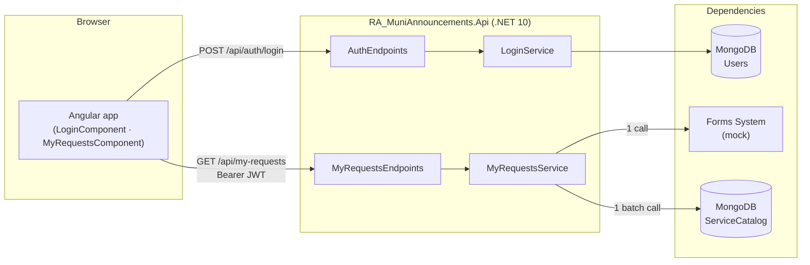
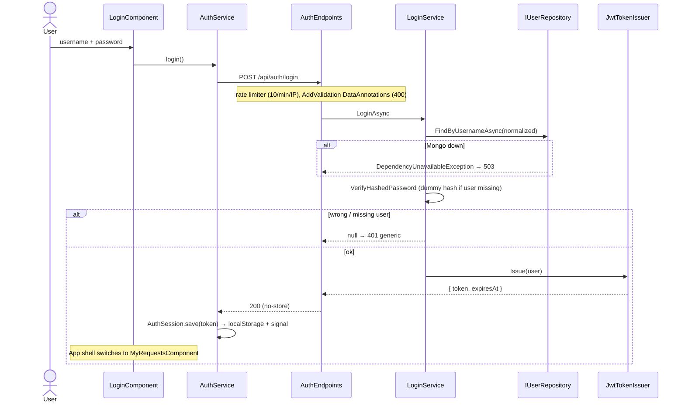
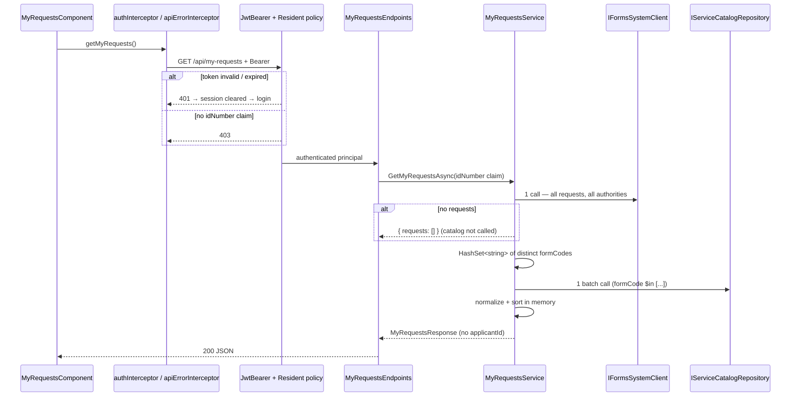
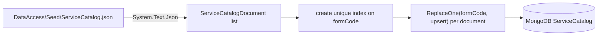
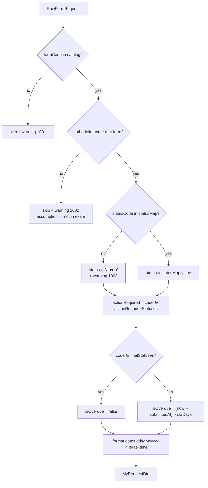
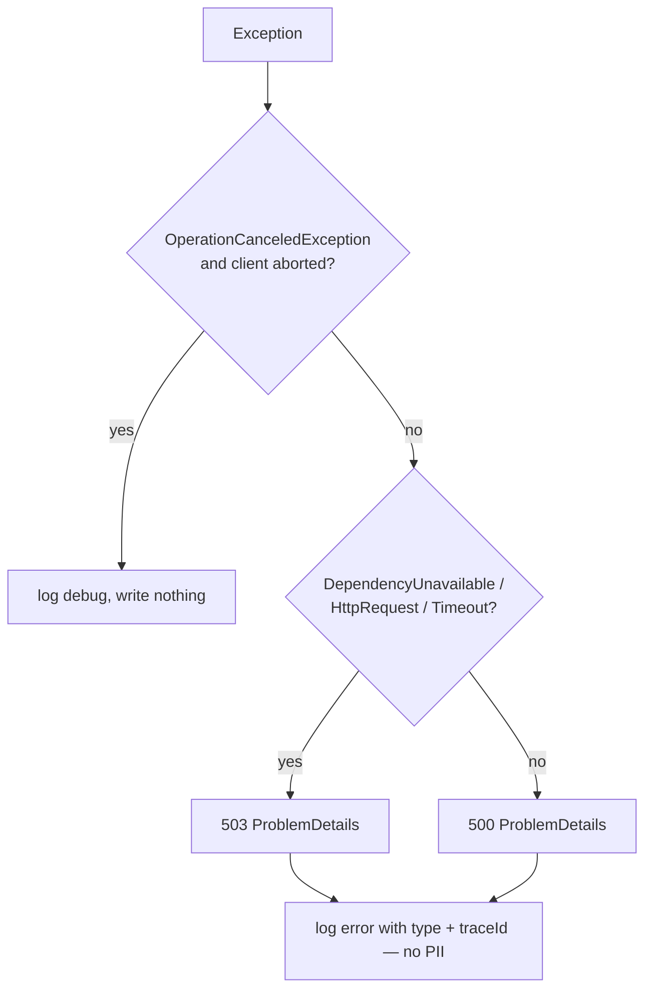
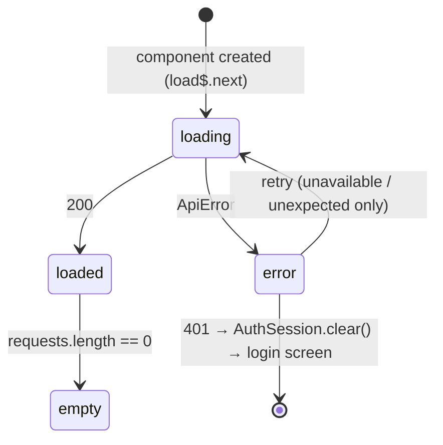

# Architecture — RA_MuniAnnouncements

Detailed reference for the APIs, the file layout and the main flows.
For setup and run instructions see the [README](../README.md).

---

## 1. Big picture



- The browser talks **only** to this service. It never calls the Forms System or MongoDB.
- Layers: **Endpoint (Minimal API) → Service → Client/Repository**, each behind an interface and wired by DI.
- ServiceCatalog and Users are real MongoDB collections sharing one `MongoClient`.
  The Forms System is an in-memory mock: its request-by-ID API is still being built (exam p.6).

---

## 2. API reference

### 2.1 `POST /api/auth/login`

| | |
|---|---|
| Auth | Anonymous |
| Rate limit | 10 requests / minute / remote IP (`login` policy) |
| Headers on response | `Cache-Control: no-store` |

Request:

```json
{ "username": "resident", "password": "••••••••••••" }
```

Response `200`:

```json
{ "token": "<JWT>", "expiresAt": "2026-10-21T12:00:00+00:00" }
```

JWT claims: `sub` (user ObjectId), `jti`, `idNumber`, plus `iss`, `aud`, `iat`, `nbf`, `exp`. Signed HS256.

| Status | When |
|---|---|
| 200 | Valid credentials |
| 400 | Missing / too long username or password (model validation) |
| 401 | Unknown user or wrong password — same generic body for both |
| 429 | Rate limit exceeded |
| 503 | Users database unavailable (`DependencyUnavailableException`) |

### 2.2 `GET /api/my-requests`

| | |
|---|---|
| Auth | `Authorization: Bearer <JWT>` + `Resident` policy (non-empty `idNumber` claim) |
| Parameters | **None.** Identity comes only from the `idNumber` claim; query strings are ignored |

Response `200`:

```json
{
  "requests": [
    {
      "requestId": "F-88213",
      "serviceName": "הנחה בארנונה",
      "authorityName": "עיריית חדרה",
      "status": "נדרשים מסמכים",
      "actionRequired": true,
      "isOverdue": false,
      "submittedAt": "02/09/2026",
      "lastUpdate": "20/09/2026"
    }
  ]
}
```

| Field | Source / rule |
|---|---|
| `requestId` | Forms System, unchanged |
| `serviceName` | `ServiceCatalog.serviceName` by `formCode` |
| `authorityName` | `authorities[authorityId].authorityName` |
| `status` | `authorities[authorityId].statusMap[statusCode]`; unknown code → `"בטיפול"` + warning 1003 |
| `actionRequired` | `statusCode ∈ actionRequiredStatuses` |
| `isOverdue` | `statusCode ∉ finalStatuses` **and** `now − submittedAt > slaDays` (strictly greater) |
| `submittedAt`, `lastUpdate` | UTC instant → Israel calendar day, `dd/MM/yyyy` |

Order: `actionRequired` first, then `lastUpdate` newest first, then `requestId` (stable tie-breaker).
`applicantId` has no property on the DTO, so it can never be serialized.

| Status | When |
|---|---|
| 200 | Valid token (an empty list is `{"requests":[]}`) |
| 401 | No / invalid / expired token, wrong key, issuer or audience |
| 403 | Valid token without an `idNumber` claim |
| 503 | Forms System or catalog unavailable (real clients) — ProblemDetails, never an empty list |
| 500 | Any other unexpected error — ProblemDetails with `traceId`, no stack trace |

### 2.3 Error body (all errors)

RFC 9457 ProblemDetails, produced by `GlobalExceptionHandler` / `UseStatusCodePages`:

```json
{ "status": 503, "title": "השירות אינו זמין כרגע", "traceId": "00-…" }
```

### 2.4 Internal contracts (interfaces)

| Interface | Method | Implementation today |
|---|---|---|
| `IFormsSystemClient` | `GetRequestsByApplicantIdAsync(applicantId, ct)` → `IReadOnlyList<RawFormRequest>` | `MockFormsSystemClient` |
| `IServiceCatalogRepository` | `GetByFormCodesAsync(formCodes, ct)` → `IReadOnlyDictionary<string, ServiceCatalogEntry>` (hits only) | `MongoServiceCatalogRepository` |
| `IMyRequestsService` | `GetMyRequestsAsync(applicantId, ct)` → `MyRequestsResponse` | `MyRequestsService` |
| `IUserRepository` | `FindByUsernameAsync`, `CreateAsync` | `MongoUserRepository` |

---

## 3. File layout

### 3.1 Backend — `src/RA_MuniAnnouncements.Api`

| Path | Responsibility |
|---|---|
| `Program.cs` | Entry point only: `AddApplicationServices()`, `TryRunCommandAsync()`, `UseApplicationMiddleware()`, `MapApplicationEndpoints()` |
| `Application/ApplicationServices.cs` | DI composition root: calls each layer's registration + web layer (validation, OpenAPI, ProblemDetails, exception handler) |
| `Application/InfrastructureServices.cs` | `MongoDbOptions`, singleton `MongoClient` (5 s server selection), both Mongo repositories; Forms System mock |
| `Application/BusinessServices.cs` | `MyRequestsOptions` (validated on start), `IMyRequestsService`, `LoginService`, `TimeProvider.System` |
| `Application/AuthenticationServices.cs` | JWT bearer, `Resident` policy, password hasher, token issuer, login rate limiter |
| `Application/ApplicationMiddleware.cs` | Pipeline order: exception handler → status code pages → rate limiter → authN → authZ |
| `Application/ApplicationEndpoints.cs` | `MapApplicationEndpoints()`: one `/api` route group that maps each endpoint module; OpenAPI (Development only) |
| `Application/CommandLineTools.cs` | `--create-user` / `--seed-catalog` switches; returns `true` when the process should exit |
| `Endpoints/MyRequestsEndpoints.cs` | `GET /api/my-requests`; `RequireAuthorization("Resident")`, reads `idNumber` claim, calls the service |
| `Endpoints/AuthEndpoints.cs` | `POST /api/auth/login`; `AllowAnonymous`, `RequireRateLimiting("login")`, `no-store` |
| `Business/MyRequestsService.cs`, `IMyRequestsService.cs` | Normalization (exam 4.1–4.7), sorting, privacy-safe logging |
| `Business/LoginService.cs` | Password verification (constant-ish time for missing users) → JWT |
| `Business/MyRequestsOptions.cs` | `DisplayTimeZoneId` (default `Asia/Jerusalem`) |
| `Models/RawFormRequest.cs` | Inbound Forms System record — contains PII (`applicantId`) |
| `Models/ServiceCatalogEntry.cs`, `AuthorityDefinition.cs` | `ServiceCatalog` document with per-authority settings |
| `Models/MyRequestDto.cs`, `MyRequestsResponse.cs` | Outbound whitelist contract (8 fields) |
| `Models/User.cs`, `LoginRequest.cs` | Users collection document; login request/response |
| `Models/Exceptions/DependencyUnavailableException.cs` | Thrown by real clients on outage → 503 |
| `ExternalServices/IFormsSystemClient.cs` | Forms System contract |
| `ExternalServices/MockFormsSystemClient.cs` | 10 hard-coded requests for 2 residents, one per edge case |
| `DataAccess/IServiceCatalogRepository.cs`, `IUserRepository.cs` | Repository contracts |
| `DataAccess/MongoServiceCatalogRepository.cs` | `ServiceCatalog` collection: one `formCode $in [...]` query; Mongo errors → `DependencyUnavailableException` |
| `DataAccess/ServiceCatalogDocument.cs` | Storage shape (exam JSON) → `ServiceCatalogEntry` with ordinal, read-only lookups; null collections → empty |
| `DataAccess/MongoUserRepository.cs` | `Users` collection; unique index on `NormalizedUsername` |
| `DataAccess/MongoDbOptions.cs` | Connection string + database name |
| `DataAccess/Seed/ServiceCatalog.json` | Catalog documents loaded by `--seed-catalog` (copied to the build output) |
| `Middleware/GlobalExceptionHandler.cs` | Exception → 503/500 ProblemDetails; client aborts are silent |
| `Security/JwtSettings.cs`, `JwtTokenIssuer.cs`, `ResidentClaims.cs` | Token settings, issuing, claim/policy names |
| `DevTools/UserProvisioner.cs` | `--create-user <username> <idNumber>`; password read from the console |
| `DevTools/ServiceCatalogSeeder.cs` | `--seed-catalog [path]`; unique index on `formCode`, upsert per document (idempotent) |

### 3.2 Tests — `tests/RA_MuniAnnouncements.Tests`

| Path | What it covers |
|---|---|
| `MyRequestsServiceTests.cs` | Exam sample, unknown status + log, overdue / final / SLA boundary, missing form / authority, multi-authority rules, sorting, single batch call, empty list, JSON contract without ID, Israel date |
| `AuthenticationTests.cs` | `WebApplicationFactory` HTTP tests: login, per-resident data, 400/401/429/503, invalid tokens (catalog served in memory from the seed file) |
| `ServiceCatalogDocumentTests.cs` | Seed file holds the exam document and leaves out the edge cases; document → entry mapping is ordinal and null-safe |
| `TestData.cs` | Builders for catalog and requests |
| `TestDoubles/` | `FixedTimeProvider`, `ListLogger`, `SpyCatalogRepository`, `StubFormsClient` |

### 3.3 Frontend — `client/my-requests-ui/src/app`

| Path | Responsibility |
|---|---|
| `app.ts` | Root shell: login screen or requests + logout, driven by `AuthSession` signal |
| `app.config.ts` | Zoneless change detection, `HttpClient` with `authInterceptor` → `apiErrorInterceptor` |
| `core/auth-session.ts` | Token signal persisted in `localStorage['auth_token']` |
| `core/auth.service.ts` | `login()` → POST, then saves the token |
| `core/auth-token.ts` | `AUTH_TOKEN_GETTER` — overridable token source (e.g. an embedding host) |
| `core/auth.interceptor.ts` | Adds Bearer header to `/api/` only; clears session on API `401` |
| `core/api-error.interceptor.ts`, `api-error.ts` | `HttpErrorResponse` → `ApiError { kind: unauthorized \| unavailable \| unexpected }` |
| `login/login.component.*` | Reactive login form, busy / error states |
| `my-requests/my-requests.component.*` | List, loading / empty / error+retry states, badges, CTA |
| `my-requests/my-requests.api.ts` | Typed `GET /api/my-requests` |
| `my-requests/my-request.model.ts` | TypeScript mirror of the API contract |
| `my-requests/request-action-url.ts` | Configurable CTA URL template (`/requests/{requestId}`) |

---

## 4. Flows

### 4.1 Login



### 4.2 `GET /api/my-requests` — request path



### 4.3 Loading the catalog (one-off command)



At request time `MongoServiceCatalogRepository` runs `Find({ formCode: { $in: codes } })` once and maps each
document with `ToEntry()`.

### 4.4 Normalization of one raw request



After the loop: sort by `actionRequired` desc → `lastUpdate` desc → `requestId`.

Cost for R requests and C distinct form codes: 2 I/O calls total, O(R) normalization with average O(1) lookups, O(R log R) sort.

### 4.5 Server error handling



### 4.6 Frontend view state



`state` is one signal holding a discriminated union, so "loading" and "error" can never be shown together.
`switchMap` cancels an in-flight load on retry; `takeUntilDestroyed` unsubscribes on destroy.

---

## 5. Logging events

| EventId | Level | Meaning | Fields (no PII) |
|---|---|---|---|
| 1001 | Warning | Form code not in ServiceCatalog — request skipped | RequestId, FormCode |
| 1002 | Warning | Authority not defined under form — request skipped | RequestId, FormCode, AuthorityId |
| 1003 | Warning | Unknown status code — shown as `בטיפול` | RequestId, FormCode, AuthorityId, StatusCode |
| 5000 | Error | Unhandled exception mapped to 503/500 | ExceptionType, StatusCode, TraceId |
| 5001 | Debug | Request aborted by client | TraceId |

---

## 6. Configuration

| Key | Default | Notes |
|---|---|---|
| `MyRequests:DisplayTimeZoneId` | `Asia/Jerusalem` | Validated on start |
| `Authentication:Jwt:Issuer` / `Audience` | `personal-area` / `ra-muni-announcements` | |
| `Authentication:Jwt:SigningKey` | empty (Development: local key) | ≥ 32 bytes; the dev key is rejected outside Development |
| `Authentication:Jwt:ExpirationMinutes` | 60 | 1–1440 |
| `MongoDb:ConnectionString` / `DatabaseName` | `mongodb://localhost:27017` / `RA_MuniAnnouncements` | Collections `ServiceCatalog` and `Users` |
